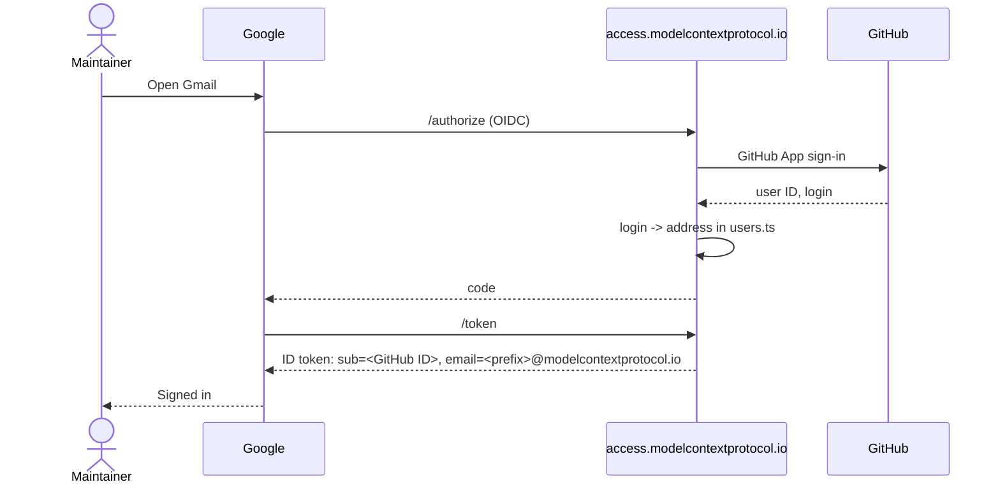

# access.modelcontextprotocol.io

Sign in to MCP Google Workspace with GitHub.

A small Cloudflare Worker (Hono, jose, D1) that is the OpenID Connect provider for Google Workspace's custom OIDC SSO profile. Maintainers sign in to Google with their GitHub account; there are no Google passwords.

Accounts stay infrastructure as code. Who has an account, and which address, is `users.ts`: a GitHub user can sign in as `<googleEmailPrefix>@modelcontextprotocol.io` only if their entry has a `googleEmailPrefix`, isn't opted out, and is in a role with `provisionUser`, the same rule Pulumi uses to create the account. The Worker bundles `src/config` and is redeployed on every config change, so removing someone from `users.ts` stops their sign-in on the next deploy.

The Worker holds no Google credentials and creates nothing in Google.

## How sign-in works



GitHub users with no account in `users.ts` get a page explaining how to request one.

D1 holds only short-lived sign-in state: pending requests (10 minutes) and single-use authorization codes (2 minutes), stored hashed and consumed with `DELETE ... RETURNING`. PKCE is enforced when Google sends it, redirect URIs must match exactly, and the client secret is compared in constant time. Sign-ins and refusals are logged as JSON lines in Workers Logs.

## Setup

Cloudflare provisioning is done by CI: on every merge to `main`, [`scripts/deploy.sh`](scripts/deploy.sh) finds or creates the `access-site` D1 database, applies migrations, and deploys the Worker with its secrets. Until the secrets below exist, the deploy job is skipped with a notice, so merging early is safe. Non-secret settings live in `wrangler.toml` and change by PR.

One-time steps:

1. **Cloudflare API token** (MCP Domain Account): create a token scoped to Workers Scripts edit, D1 edit, and Workers Routes and DNS edit on the `modelcontextprotocol.io` zone. Store it as `CLOUDFLARE_ACCESS_SITE_TOKEN` in the `production` environment.
2. **OIDC keys**, generated locally and stored straight into GitHub secrets without being printed (needs `openssl` and `gh`):
   ```sh
   openssl genpkey -algorithm RSA -pkeyopt rsa_keygen_bits:2048 \
     | gh secret set ACCESS_SITE_OIDC_SIGNING_KEY --env production -R modelcontextprotocol/access
   openssl rand -base64 32 | tr '+/' '-_' | tr -d '=\n' > oidc-client-secret.txt
   gh secret set ACCESS_SITE_OIDC_CLIENT_SECRET --env production -R modelcontextprotocol/access < oidc-client-secret.txt
   ```
   Keep `oidc-client-secret.txt` until step 4 (Google needs the same value), then delete it.
3. **GitHub App** (org owner): org-owned, callback URL `https://access.modelcontextprotocol.io/login`, permission Account → Email addresses: read-only (the sign-in library reads it; it is not used), no repository or organization permissions. Put its client ID in `GITHUB_CLIENT_ID` in `wrangler.toml` (PR) and its client secret in `ACCESS_SITE_GITHUB_CLIENT_SECRET` (production environment).
4. **Google SSO profile** (super admin), once the Worker is live: Security → Authentication → SSO with third-party IdP → add a custom **OIDC** profile with issuer `https://access.modelcontextprotocol.io`, client ID `google-workspace`, and the client secret from step 2. Put the redirect URI Google shows into `OIDC_REDIRECT_URIS` in `wrangler.toml` (PR). Assign the profile to a pilot sub-OU first, then to **Model Context Protocol**. Super admins always keep Google sign-in, which is the break-glass path.

## Operations

- **Rotate the signing key**: copy the current key object (`keys[0]`) from `https://access.modelcontextprotocol.io/jwks` into the `ACCESS_SITE_OIDC_PREVIOUS_JWK` secret, replace `ACCESS_SITE_OIDC_SIGNING_KEY` as in setup step 2, and re-run the workflow. A day later set `ACCESS_SITE_OIDC_PREVIOUS_JWK` to `{}` and re-run.
- **Logs**: sign-ins and refusals are JSON lines in Workers Logs (dashboard, or `npx wrangler tail`).

## Development

```sh
npm ci
npm test         # vitest, Node 22+ (uses node:sqlite in place of D1)
npm run typecheck
npm run dev      # wrangler dev
```

## To verify on first deploy

- Whether Google sends PKCE (both cases are handled) and the exact redirect URI it uses.
