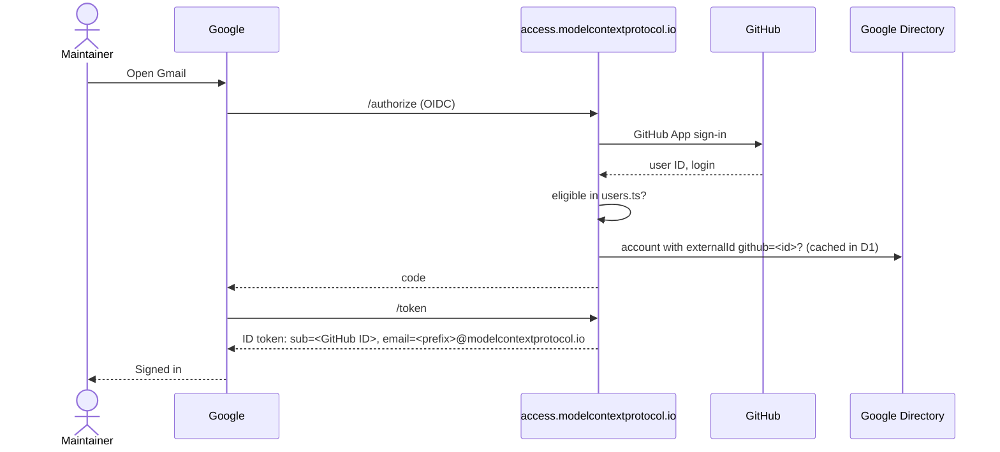

# access.modelcontextprotocol.io

Sign in to MCP Google Workspace with GitHub, and self-service `@modelcontextprotocol.io` accounts.

A Cloudflare Worker (Hono, jose, D1) that:

- is a minimal OpenID Connect provider for Google Workspace's custom OIDC SSO profile, keyed on the numeric GitHub user ID
- lets eligible maintainers create their own account, or link the one already configured for them in `users.ts`
- runs nightly to refresh its account cache and suspend accounts whose owners are no longer eligible

Eligibility is exactly the Pulumi rule: a member of a role with `provisionUser` (directly or through a child team). The Worker bundles `src/config`, so it is redeployed whenever the config changes.

## How sign-in works



Users who are eligible but have no account, or whose account is suspended, land on the account page instead of being sent back to Google.

## Account page

- **Configured in `users.ts`** (`googleEmailPrefix` set): confirms that address and links it to the GitHub ID, creating it if it doesn't exist yet.
- **Eligible, not configured**: picks a name and email prefix; the account is created immediately in the MCP OU with the GitHub ID in `externalIds`. Reserved names and team slugs are refused.
- **Not eligible**: explains which roles grant accounts.

Accounts are never deleted. Leaving every eligible team makes the next sign-in fail, and the nightly job suspends the account (report-only until `OFFBOARDING_MODE = "enforce"`; it refuses to suspend more than `OFFBOARDING_MAX_PER_RUN` in one run, and skips any account whose GitHub lookup fails).

## Setup

One-time, in this order.

1. **GitHub App** (org-owned). Callback URL `https://access.modelcontextprotocol.io/login`. Permissions: Account → Email addresses: read-only (the sign-in library reads the primary email; it is not used). No repository or organization permissions. Note the client ID and generate a client secret.
2. **Google service account**. Create it in the `mcp-access-prod` GCP project and download a JSON key. In the Admin console, create a custom admin role with Users: Create, Read, Update (not Delete), assign it to the service account, and scope the assignment to the **Model Context Protocol** OU.
3. **Cloudflare**:
   ```sh
   cd access-site
   npm ci
   npx wrangler d1 create access-site          # put the database_id in wrangler.toml
   npm run migrate
   ```
   Set `GITHUB_CLIENT_ID` in `wrangler.toml`, then the secrets:
   ```sh
   npm run generate-keys                       # OIDC_SIGNING_KEY + OIDC_CLIENT_SECRET (printed once)
   npx wrangler secret put GITHUB_CLIENT_SECRET
   npx wrangler secret put GOOGLE_SA_KEY < key.json
   npx wrangler secret put DISCORD_WEBHOOK_URL # optional
   npx wrangler secret put GITHUB_API_TOKEN    # optional, read-only token for the nightly job
   ```
4. **Backfill** existing accounts with GitHub IDs (from the repo root, with the Pulumi service account key):
   ```sh
   GOOGLE_SA_KEY="$(cat sa-key.json)" GITHUB_TOKEN=... npx ts-node scripts/backfill-github-ids.ts          # dry run
   GOOGLE_SA_KEY="$(cat sa-key.json)" GITHUB_TOKEN=... npx ts-node scripts/backfill-github-ids.ts --apply
   ```
   Fix anything it reports. Anyone missed can still link themselves on the account page.
5. **Google SSO profile** (super admin): Security → Authentication → SSO with third-party IdP → add a custom **OIDC** profile.
   - Issuer: `https://access.modelcontextprotocol.io`
   - Client ID: `google-workspace`, client secret: the value from `generate-keys`
   - Put the redirect URI Google shows into `OIDC_REDIRECT_URIS` in `wrangler.toml` and deploy.
   - Assign the profile to a pilot sub-OU first, then to **Model Context Protocol**. Super admins always keep Google sign-in.
6. **CI**: add `CLOUDFLARE_ACCESS_SITE_TOKEN` (Workers Scripts edit, D1 edit, Workers Routes / DNS edit on the zone) to the `production` environment and `CLOUDFLARE_ACCOUNT_ID` as a repository variable. Merges to `main` then test, migrate and deploy (`.github/workflows/access-site.yml`).

## Operations

- **Turn on offboarding**: after a few clean report-only runs, set `OFFBOARDING_MODE = "enforce"`.
- **Rotate the signing key**: copy the current key from `/jwks` into the `OIDC_PREVIOUS_JWK` secret, run `node scripts/generate-keys.mjs --rotate`, deploy; remove `OIDC_PREVIOUS_JWK` a day later.
- **Audit**: `npx wrangler d1 execute access-site --remote --command "SELECT * FROM audit_log ORDER BY id DESC LIMIT 50"`.
- **Break-glass**: super admins are exempt from the SSO profile, so they can always sign in to fix things.

## Development

```sh
npm ci
npm test         # vitest, Node 22+ (uses node:sqlite in place of D1)
npm run typecheck
npm run dev      # wrangler dev
```

## To verify against the live services

- Directory API search by `externalId:<id>` (`findUserByGithubId`); the nightly job rebuilds the D1 cache from a full OU listing, so sign-in works even if this search does not.
- Whether Google sends PKCE in its OIDC requests (both cases are supported) and the exact redirect URI it uses.
