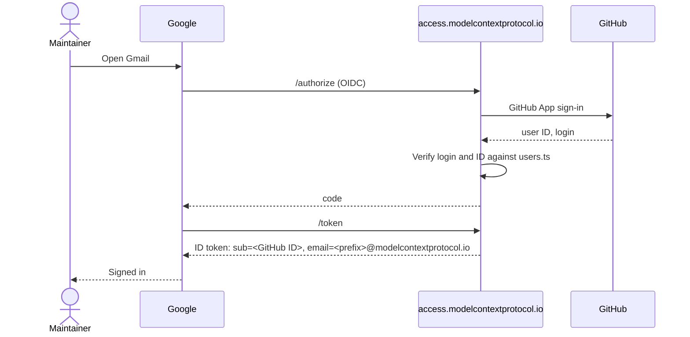

# access.modelcontextprotocol.io

Sign in to MCP Google Workspace with GitHub.

A small Cloudflare Worker (Hono, jose, D1) that is the OpenID Connect provider for Google Workspace's custom OIDC SSO profile. Maintainers sign in to Google with their GitHub account; there are no Google passwords.

Accounts stay infrastructure as code. A member in `users.ts` can sign in as `<googleEmailPrefix>@modelcontextprotocol.io` when the entry declares an existing Workspace account or qualifies for Pulumi provisioning, and the GitHub login and verified numeric `githubUserId` both match. The Worker bundles `src/config` and redeploys on config changes, so removing a member from `users.ts` stops new sign-ins on the next deploy.

The Worker holds no Google credentials and creates nothing in Google.

## How sign-in works



GitHub users who cannot sign in get a page explaining the next step.

## Security

- **Accounts come from `users.ts`**, which only core maintainers can approve (CODEOWNERS). Treat changes to `githubUserId` or `googleEmailPrefix` like credential changes.
- **GitHub accounts are verified before sign-in.** The numeric ID must already be in `users.ts`. A recycled GitHub login cannot claim the original member’s Workspace address, even on its first sign-in.
- **Codes and requests are single-use and short-lived.** Pending requests last 10 minutes and authorization codes last 2 minutes. D1 stores them hashed and consumes them with `DELETE ... RETURNING`. GitHub OAuth state and S256 PKCE are bound to the same host-only pending request cookie. The Google flow enforces PKCE when sent and rejects a verifier without a challenge (RFC 9700). Redirect URIs must match exactly. Client credentials are form-decoded (RFC 6749 2.3.1) and compared in constant time.
- **Rate limited**: `/authorize` and `/login` allow 30 requests per minute per IP, so anonymous traffic can't exhaust D1 writes.
- **Minimal GitHub access**: the GitHub App has no repository or organization permissions, and its user token is revoked right after the user is read.
- **No Google credentials** in the Worker; it cannot create, change or read Google accounts.
- **CI**: actions are pinned to commit SHAs, Git credentials aren't persisted, and deploy secrets are only exposed to the deploy step, never to `npm ci`.
- **Break-glass**: super admins are exempt from the SSO profile. The GitHub org requires 2FA, which covers Google skipping its own 2-step verification for SSO users.

Sign-ins and refusals are logged as JSON lines in Workers Logs.

## Setup

Cloudflare provisioning is done by CI: on every merge to `main`, [`scripts/deploy.sh`](scripts/deploy.sh) finds or creates the `access-site` D1 database, applies migrations, and deploys the Worker with its secrets. Until the secrets below exist, the deploy job is skipped with a notice, so merging early is safe. Non-secret settings live in `wrangler.toml` and change by PR.

One-time steps, in order. Secrets go straight from the command line into GitHub secrets (needs `openssl` and `gh`), so they never pass between people.

1. **Cloudflare API token** (Cloudflare admin): create a token on the MCP Domain Account scoped to Workers Scripts edit, D1 edit, and Workers Routes and DNS edit on the `modelcontextprotocol.io` zone. Store it as `CLOUDFLARE_ACCESS_SITE_TOKEN` in the `production` environment.
2. **OIDC signing key** (anyone with access to the repo's secrets):
   ```sh
   openssl genpkey -algorithm RSA -pkeyopt rsa_keygen_bits:2048 \
     | gh secret set ACCESS_SITE_OIDC_SIGNING_KEY --env production -R modelcontextprotocol/access
   ```
3. **GitHub App** (org owner): create it at <https://github.com/organizations/modelcontextprotocol/settings/apps/new>.
   - Homepage URL `https://access.modelcontextprotocol.io`, callback URL `https://access.modelcontextprotocol.io/login`; leave token expiry on; no device flow; webhook off
   - Leave repository, organization, and account permissions unset. The Worker reads only the authenticated GitHub user’s basic profile.
   - Installable only on this account; no need to install it
   - Generate a client secret and store it: `gh secret set ACCESS_SITE_GITHUB_CLIENT_SECRET --env production -R modelcontextprotocol/access` (paste when prompted)
   - Put the client ID (not secret) in `GITHUB_CLIENT_ID` in `wrangler.toml` by PR
4. **OIDC client secret** (whoever does step 6, so it stays with one person):
   ```sh
   openssl rand -base64 32 | tr '+/' '-_' | tr -d '=\n' > oidc-client-secret.txt
   gh secret set ACCESS_SITE_OIDC_CLIENT_SECRET --env production -R modelcontextprotocol/access < oidc-client-secret.txt
   ```
   Keep `oidc-client-secret.txt` for step 6, then delete it.
5. **Deploy**: merge (or re-run the `access-site` workflow) and check `https://access.modelcontextprotocol.io/.well-known/openid-configuration`.
6. **Google SSO profile** (super admin): in the [Admin console](https://admin.google.com), Security → Authentication → SSO with third-party IdP → add a custom **OIDC** profile:
   - Issuer URL `https://access.modelcontextprotocol.io`, client ID `google-workspace`, client secret from step 4
   - Change password URL `https://github.com/settings/security` (passwords now live on GitHub)
   - Copy the **Redirect URI** Google shows into `OIDC_REDIRECT_URIS` in `wrangler.toml` by PR
   - Assign the profile to a pilot sub-OU holding only the pilot users first. Follow the rollout steps below before assigning it more widely. Super admins always keep Google sign-in, which is the break-glass path.

## Operations

- **Pilot rollout.** `PILOT_GITHUB_LOGINS` in `wrangler.toml` limits sign-in to the listed logins (initially `sambhav`). Before adding anyone, confirm the GitHub account with the maintainer and check its numeric ID against a trusted GitHub record. Add `githubUserId` to their `users.ts` entry in a reviewed PR. Keep the Google profile scoped to users whose IDs are verified and whose GitHub sign-in is enabled. Before removing the pilot allowlist and assigning the profile to the entire **Model Context Protocol** OU, verify IDs and account mappings for everyone affected, including existing Workspace accounts.
- **GitHub renames.** Confirm the new login against the existing ID, then update the login in `users.ts` and in the pilot list if applicable. A recreated GitHub account has a different ID and requires fresh verification.
- **Rotate the signing key.**
  1. Generate a new private key as in setup step 2, and keep it offline until the cutover. Export its public JWK with the same RFC 7638 thumbprint the Worker uses for its `kid`.
  2. Set `ACCESS_SITE_OIDC_NEXT_JWK` to the new public JWK and re-run the workflow. Check that `/jwks` contains both keys and wait at least five minutes for caches to refresh.
  3. Set `ACCESS_SITE_OIDC_PREVIOUS_JWK` to the old public JWK, then replace `ACCESS_SITE_OIDC_SIGNING_KEY` with the new private key and deploy. Check that sign-in works and that `/jwks` still lists both keys. The Worker deduplicates the active key while it is also in the next slot.
  4. After a day, set both `ACCESS_SITE_OIDC_PREVIOUS_JWK` and `ACCESS_SITE_OIDC_NEXT_JWK` to `{}` and re-run the workflow.
- **Logs.** `signin.denied` with `reason: identity_mismatch` means the returned GitHub ID differed from the configured ID. `identity_unverified` means the account still needs a reviewed ID.

## Development

```sh
npm ci
npm test         # vitest, Node 24+ (uses node:sqlite in place of D1)
npm run typecheck
npm run dev      # wrangler dev
```

## Google behaviour

- The redirect URI is specific to each SSO profile and only shown once the profile exists, so it is set by PR after setup step 6.
- Google doesn't document whether it sends PKCE; both cases are supported.
