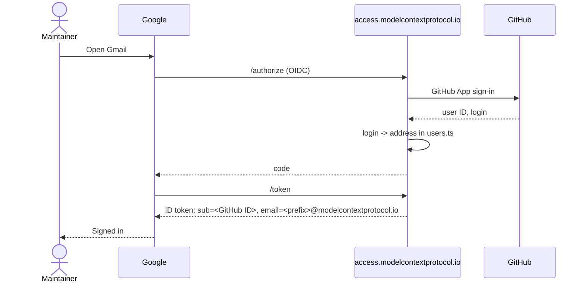

# access.modelcontextprotocol.io

Sign in to MCP Google Workspace with GitHub.

A small Cloudflare Worker (Hono, jose, D1) that is the OpenID Connect provider for Google Workspace's custom OIDC SSO profile. Maintainers sign in to Google with their GitHub account; there are no Google passwords.

Accounts stay infrastructure as code. Who has an account, and which address, is `users.ts`: a GitHub user can sign in as `<googleEmailPrefix>@modelcontextprotocol.io` only if their entry has a `googleEmailPrefix`, isn't opted out, and is in a role with `provisionUser`, the same rule Pulumi uses to create the account. The Worker bundles `src/config` and is redeployed on every config change, so removing someone from `users.ts` stops their sign-in on the next deploy.

The Worker holds no Google credentials and creates nothing in Google.

## How sign-in works



GitHub users with no account in `users.ts` get a page explaining how to request one.

D1 holds only short-lived sign-in state: pending requests (10 minutes) and single-use authorization codes (2 minutes), stored hashed and consumed with `DELETE ... RETURNING`. PKCE is enforced when Google sends it, redirect URIs must match exactly, and the client secret is compared in constant time. Sign-ins and refusals are logged as JSON lines in Workers Logs.

## Setup

One-time, in this order.

1. **GitHub App** (org-owned). Callback URL `https://access.modelcontextprotocol.io/login`. Permissions: Account → Email addresses: read-only (the sign-in library reads it; it is not used). No repository or organization permissions. Note the client ID and generate a client secret.
2. **Cloudflare**:
   ```sh
   cd access-site
   npm ci
   npx wrangler d1 create access-site          # put the database_id in wrangler.toml
   npm run migrate
   ```
   Set `GITHUB_CLIENT_ID` in `wrangler.toml`, then the secrets:
   ```sh
   npm run generate-keys                       # OIDC_SIGNING_KEY + OIDC_CLIENT_SECRET (printed once)
   npx wrangler secret put GITHUB_CLIENT_SECRET
   ```
3. **Google SSO profile** (super admin): Security → Authentication → SSO with third-party IdP → add a custom **OIDC** profile.
   - Issuer: `https://access.modelcontextprotocol.io`
   - Client ID: `google-workspace`, client secret: the value from `generate-keys`
   - Put the redirect URI Google shows into `OIDC_REDIRECT_URIS` in `wrangler.toml` and deploy.
   - Assign the profile to a pilot sub-OU first, then to **Model Context Protocol**. Super admins always keep Google sign-in, which is the break-glass path.
4. **CI**: add `CLOUDFLARE_ACCESS_SITE_TOKEN` (Workers Scripts edit, D1 edit, Workers Routes / DNS edit on the zone) to the `production` environment and `CLOUDFLARE_ACCOUNT_ID` as a repository variable. Merges to `main` then test, migrate and deploy (`.github/workflows/access-site.yml`).

## Operations

- **Rotate the signing key**: copy the current key from `/jwks` into the `OIDC_PREVIOUS_JWK` secret, run `node scripts/generate-keys.mjs --rotate`, deploy; remove `OIDC_PREVIOUS_JWK` a day later.
- **Logs**: Workers Logs in the dashboard, or `npx wrangler tail` live.

## Development

```sh
npm ci
npm test         # vitest, Node 22+ (uses node:sqlite in place of D1)
npm run typecheck
npm run dev      # wrangler dev
```

## To verify on first deploy

- Whether Google sends PKCE (both cases are handled) and the exact redirect URI it uses.
